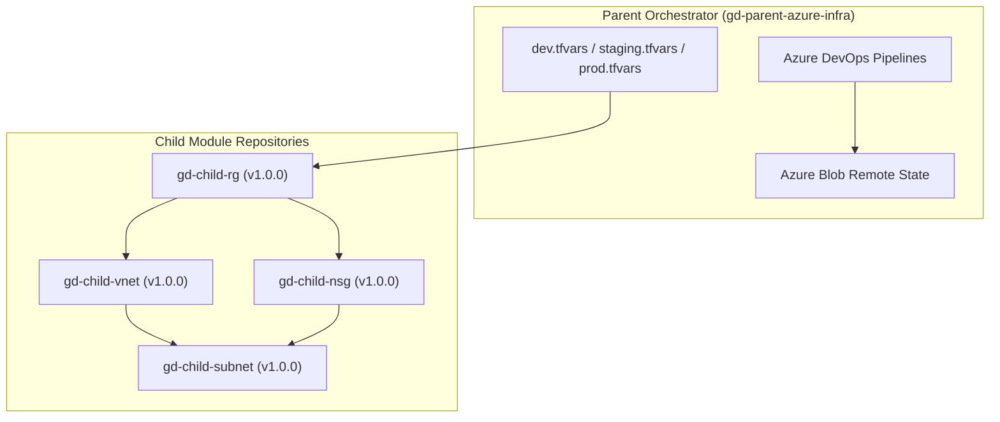

# Architecture Overview: Parent–Child Repository Pattern

## 1. Architectural Philosophy

Traditional monolithic Terraform repositories suffer from:
- Large blast radiuses
- Monolithic state locks causing pipeline contention
- Inability to independently version and test reusable components

The **Parent–Child Repository Pattern** addresses this by establishing:
1. **Child Repositories (`gd-child-*`)**: Single-responsibility, reusable Terraform modules. Each child repository is independently versioned with semantic release tags (`v1.0.0`), has its own unit tests, examples, and CI/CD validation.
2. **Parent Repository (`gd-parent-azure-infra`)**: An orchestrator that consumes pinned releases of child modules, establishes inter-module wiring (inputs/outputs), handles environment configuration (`dev`, `staging`, `prod`), and manages remote state lifecycles.



## 2. Pinned Version References

All child module invocations in the parent repository must reference tagged releases:

```hcl
module "rg" {
  source = "git::https://github.com/gauravdubey5/gd-child-rg.git?ref=v1.0.0"
  ...
}
```

Never consume moving targets like `main` or `HEAD` in production environments.

## 3. Environment Separation

- **`dev`**: Fast iteration, minimal resources, zero unnecessary spend.
- **`staging`**: Mirror of production topology with reduced SKUs.
- **`prod`**: Multi-AZ deployments, CanNotDelete management locks, automated backups, and strict approval gates in CI/CD.
